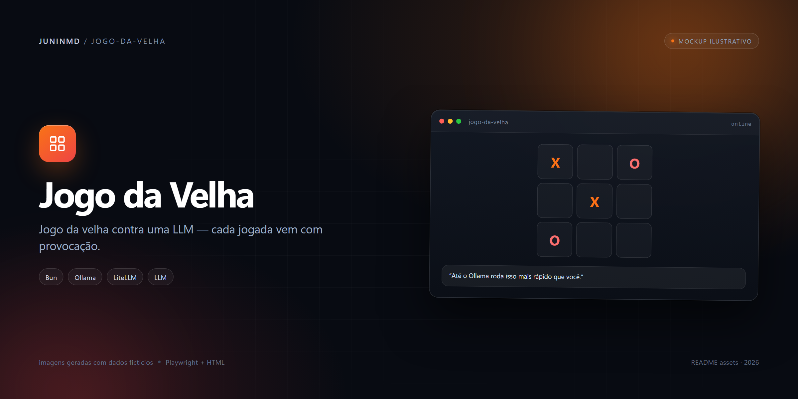
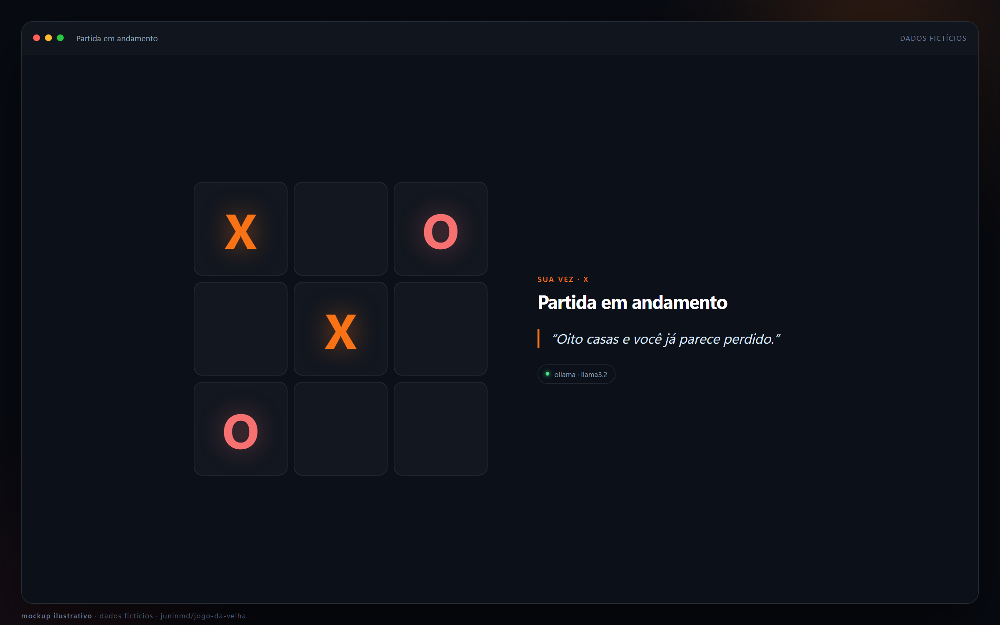

# Jogo da Velha contra uma LLM

<p align="center">
  
</p>

Jogo da velha em que você é **X**, a máquina é **O** e cada jogada vem com uma provocação gerada pelo modelo. Dois provedores atrás da mesma interface: Ollama para rodar local e qualquer gateway compatível com a API OpenAI (aqui, LiteLLM) para rodar no cluster.

[](https://github.com/juninmd/jogo-da-velha/actions/workflows/validate.yml)

O projeto usa só a stdlib do Bun: não há dependências de runtime, nem `node_modules`, nem build de frontend. `src/index.html` é servido pelo próprio servidor.

## Rodar local

Pré-requisito: [Bun](https://bun.sh).

```bash
bun run start        # equivale a bun run src/server.ts
# o console imprime o modelo e a URL, por padrão http://localhost:3737
```

Abra `http://localhost:3737`. Sem o provedor no ar, o jogo continua funcionando com o fallback tático e as provocações locais; o console avisa que o warmup falhou.

Para desenvolvimento com reload:

```bash
bun run dev
```

## Provedores

O provedor é escolhido por `AI_PROVIDER`. O padrão do código é `openai`; a imagem Docker também fixa `AI_PROVIDER=openai`.

| | `AI_PROVIDER=ollama` | `AI_PROVIDER=openai` |
|---|---|---|
| Endpoint | `{OLLAMA_HOST}/api/chat` | `{OPENAI_BASE_URL}/chat/completions` |
| Modelo padrão | `qwen-fast:latest` | `cloud/auto` |
| Formato JSON | `format: "json"` | `response_format: { "type": "json_object" }` |
| Extras | `think: false`, `keep_alive` | `cache: { "no-cache": true }` no corpo |
| Autenticação | nenhuma | `Authorization: Bearer {OPENAI_API_KEY}` |

O `cache` no-corpo é deliberado: o LiteLLM faz cache de resposta e, sem o bypass, o mesmo tabuleiro devolve sempre a mesma piada em poucos milissegundos. O bypass é no corpo porque não existe header `x-litellm-no-cache`.

### Variáveis de ambiente

| Variável | Padrão | Usada por |
|---|---|---|
| `AI_PROVIDER` | `openai` | Seleciona o provedor |
| `OPENAI_BASE_URL` | `http://litellm.ai.svc.cluster.local:4000/v1` | `openai` |
| `OPENAI_API_KEY` | vazio | `openai` |
| `OPENAI_MODEL` | `cloud/auto` | `openai` |
| `OLLAMA_HOST` | `127.0.0.1:11434` | `ollama`; aceita com ou sem `http://` |
| `OLLAMA_MODEL` | `qwen-fast:latest` | `ollama` |
| `OLLAMA_KEEP_ALIVE` | `30m` | `ollama`; mantém o modelo residente |
| `PORT` | `3737` | HTTP |

O `Dockerfile` sobrescreve `PORT=3000` e `AI_PROVIDER=openai` como padrão da imagem.

## API

O servidor usa `Bun.serve` e responde em quatro rotas:

| Método | Rota | O que faz |
|---|---|---|
| `GET` | `/` | Serve o HTML do jogo |
| `GET` | `/health` | `{ "ok": true, "model": "<modelo>" }` |
| `POST` | `/api/move` | Recebe `{ "board": [...] }`, valida o tabuleiro, pede a jogada ao modelo e devolve a jogada de `O` |
| `POST` | `/api/endgame` | Comentário final quando a IA não venceu; recusa se a partida não terminou ou se `O` ganhou |

O tabuleiro é um array de 9 posições com `"X"`, `"O"` ou `null`, na ordem `0..8`. Antes de chamar o modelo, o servidor valida:

- exatamente 9 células, só `X`/`O`/`null`;
- contagem coerente (`X == O` ou `X == O + 1`);
- partida não encerrada e com jogadas livres;
- é a vez de `O` (`X == O + 1`), senão `400`.

Exemplo de chamada (ilustrativo — `X` abriu no canto):

```bash
curl -s http://localhost:3737/api/move \
  -H 'content-type: application/json' \
  -d '{"board":["X",null,null,null,null,null,null,null,null]}'
```

Resposta: `move`, `taunt`, `mood`, `tauntSource` (`model` ou `local`), `source` (`model` ou `fallback`), `error`, `ms`, `board` atualizado e o estado (`over`, `winner`, `line`, `draw`).

Se o modelo devolver uma jogada ilegal, o servidor tenta de novo até três vezes (a segunda e a terceira com temperatura menor e uma dica listando as casas livres). Se continuar sem jogada legal, timeout ou Ollama fora do ar, entra o `fallbackMove()`: vencer, senão bloquear, senão centro/canto. A UI mostra a origem da jogada (`model` ou `fallback`) e o erro, e a partida não trava.

## Humor e zoeira

`moodOf()` (`src/game.ts`) classifica o tabuleiro **antes** da jogada da IA, contando em quantas casas o `X` fecharia o jogo na próxima:

| Ameaças do X | Humor | Efeito |
|---|---|---|
| A IA fecha agora | `calma` | Deboche tranquilo |
| 1 | `nervosa` | Defensiva, culpa distração; balão âmbar tremendo |
| 2 ou mais | `raiva` | Surta em caixa alta culpando GPU, quantização ou lag; balão vermelho |

Duas ameaças simultâneas são derrota matemática, então a raiva aparece **antes** da derrota, não depois. O humor entra no prompt (muda o tom), escolhe a lista de frases locais no fallback e vai no JSON para o cliente. A derrota no `/api/endgame` é sempre `raiva`.

A zoeira vem no mesmo JSON da jogada (`{"move": <índice>, "zoeira": "<texto>"}`), sem uma segunda inferência: no Ollama as requisições são serializadas, e um segundo call dobraria a espera por turno. O servidor limita a provocação a 120 caracteres e corta na última fronteira de palavra quando o modelo ignora o limite. Se o modelo não devolver texto utilizável, entra uma frase local.

## Desempenho e modelos

O boot faz `warmup()`: no Ollama, carrega o modelo e o mantém residente por `keep_alive` (o cold start de um modelo grande faria as primeiras jogadas caírem no fallback); no LiteLLM, faz uma chamada real para validar chave e modelo antes de alguém jogar.

Evidência medida pelo autor, preservada do README anterior:

| Modelo no LiteLLM | Resultado |
|---|---|
| `cloud/llama-8b` | Responde em 0,6–2 s com JSON válido; o indicado para o jogo |
| `cloud/gpt-oss-120b`, `cloud/qwen-coder` | `content` vazio com `finish_reason=length` (modelos de raciocínio) |
| `cloud/maverick` | Ignora `response_format` |
| `cloud/llama-70b` | Oscila entre 4 e 32 s |

Por isso o código usa `cloud/auto` como padrão e permite fixar o modelo por `OPENAI_MODEL`. Para reproduzir o comportamento acima, defina `OPENAI_MODEL=cloud/llama-8b`.

`qwen-fast` no Ollama é um modelo *thinking*: sem `think: false` ele gasta o orçamento de tokens raciocinando e devolve `content` vazio. Com `think: false`, responde em cerca de 1–3 s. Esses números vêm do README anterior, não de um benchmark reproduzido por este documento.

## Jogar pelo celular na mesma rede

O servidor escuta em todas as interfaces e imprime a URL da LAN no boot. No Windows, a regra de firewall precisa ser criada uma vez, com admin, limitada à sub-rede local:

```powershell
New-NetFirewallRule -DisplayName "jogo-da-velha 3737" -Direction Inbound -Protocol TCP `
  -LocalPort 3737 -Action Allow -Profile Any -RemoteAddress LocalSubnet
```

Se o roteador tiver isolamento de clientes (AP isolation), o celular não alcança o PC nem com a regra criada.

## Docker

```bash
docker build -t jogo-da-velha .
docker run --rm -p 3000:3000 \
  -e AI_PROVIDER=openai \
  -e OPENAI_BASE_URL=http://<gateway>:4000/v1 \
  -e OPENAI_API_KEY=<chave> \
  -e OPENAI_MODEL=cloud/llama-8b \
  jogo-da-velha
```

A imagem é `oven/bun:1`, roda como usuário `bun`, expõe `3000` e não instala dependências. Para usar Ollama a partir do container, aponte `OLLAMA_HOST` para um endereço alcançável pelo container e publique a porta correspondente; `127.0.0.1` dentro do container é o próprio container.

## Cluster

Não há manifests de Kubernetes neste repositório. O processo só precisa das variáveis acima; num cluster, o caminho normal é `AI_PROVIDER=openai` com `OPENAI_BASE_URL` apontando para o serviço interno do LiteLLM e `OPENAI_API_KEY` vindo de um Secret. O chart e o deploy ficam fora deste repositório.

## Smoke test

Com o servidor no ar:

```bash
bun run smoke
```

O script (`scripts/smoke.ts`) valida a lógica de humor sem modelo, joga uma partida inteira como `X`, confere se cada jogada de `O` é legal, se a zoeira existe, se o humor devolvido bate com o cálculo local e se `/api/endgame` responde `raiva` quando a IA perde. Também exige `400` para um tabuleiro com turno inválido. Ele usa `BASE` (padrão `http://localhost:3737`).

## Imagens

> [!NOTE]
> **Mockups ilustrativos.** As telas abaixo foram geradas em HTML com dados fictícios (Playwright) e não são capturas de uma instalação real.

<p align="center">
  
  <br>
  <sub>Partida em andamento — dados fictícios.</sub>
</p>


## Limitações

- **Sem autenticação, placar ou persistência.** Cada partida vive no navegador; o servidor não guarda histórico nem ranking.
- **Uma partida por requisição, sem estado no servidor.** O cliente manda o tabuleiro inteiro e o servidor confia no formato validado, não em uma sessão.
- **A qualidade depende do modelo.** Modelos de raciocínio podem devolver conteúdo vazio; modelos que ignoram `response_format` quebram o parser e caem no fallback. A lista de modelos que não funcionam está acima.
- **O fallback é tático, não imbatível.** Ele vence, bloqueia, depois prefere centro e cantos; não é um solver perfeito.
- **A zoeira pode repetir.** O bypass de cache depende do gateway honrar `cache: {"no-cache": true}`.
- **Não há suíte de testes unitários nem script `test`.** A verificação automatizada do repositório é o smoke test HTTP mais os workflows de validação e build da imagem.
- **Sem arquivo de licença.** Não há `LICENSE` no repositório.
- O HTML, o CSS e o JavaScript do cliente ficam todos em `src/index.html`; não há build separado.
